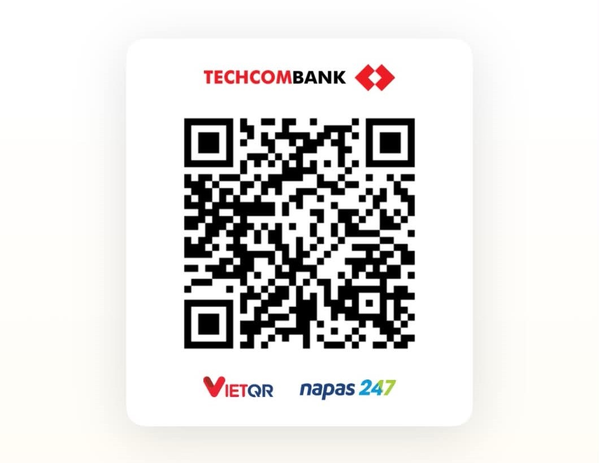

# Hang MU · Off Fanclub Manchester United

Hang động Manchester United 2.5D cho TikTok LIVE, nơi anh em fan Quỷ đỏ off với nhau. Người xem bình luận là bước vào hang, chọn đứng, ngồi, nằm, khóc hay chửi lớn để cổ vũ. Ai tặng quà được xướng tên cảm ơn bằng giọng đọc tiếng Việt, kèm tiếng kèn và pháo giấy. Nhạc nền là **Glory Glory Man United**. Ban chủ nhiệm Fanclub đứng trên bục dẫn dắt buổi live.

Mã nguồn chia sẻ miễn phí, giấy phép MIT.

## Gồm những gì

| Thư mục / file | Là gì |
|---|---|
| `index.html`, `assets/` | Bản web tĩnh: ai cũng tự vào hang, chọn nhân vật và hành động, bấm tặng quà thử. Đăng được lên Cloudflare Pages hoặc bất kỳ host tĩnh nào. |
| `live/` | Bộ công cụ phát LIVE: server Node, overlay 9:16 để ghép vào TikTok LIVE Studio hoặc OBS, bảng điều khiển. |
| `assets/` | Ảnh nền hang, ảnh nhân vật theo hành động, ảnh ban chủ nhiệm, nhạc nền. |
| `pose-prompts.md` | Prompt Google Flow để tạo ảnh 2 nhân vật × 5 hành động. |
| `leader-prompts.md` | Prompt tạo ảnh ban chủ nhiệm: Chủ nhiệm, Phó Fanclub, Admin. |

## Chạy bộ LIVE trên máy phát

Cần Node.js 20 trở lên và máy có Internet (giọng đọc chạy qua mạng).

```bash
cd live
npm install
npm start
```

1. Mở `http://localhost:3000/live/control.html` (bảng điều khiển).
2. Bấm **Mở màn hình overlay 9:16**, rồi bấm **🔊 Bấm để bật âm thanh** một lần trong cửa sổ đó (trình duyệt chặn tự phát tiếng).
3. Trong TikTok LIVE Studio: *Add source → Window capture* → chọn cửa sổ overlay. Với OBS thì dùng *Browser source* trỏ tới `http://localhost:3000/live/overlay.html`, kích thước 1080×1920.
4. Bật LIVE trên TikTok, nhập `@username` vào bảng điều khiển, bấm **Kết nối**.

Chưa live vẫn thử được: dùng **Thử tương tác**, **Đổ người mẫu 15/36/64/100** hoặc **Bot tương tác mô phỏng**.

### Người xem làm được gì

| Người xem | Trên màn hình |
|---|---|
| Bình luận bất kỳ | Nhân vật đi vào hang và đứng vào chỗ trên thảm đỏ. Tối đa 100 chỗ, tự mở rộng 24 → 36 → 64 → 100. Đầy chỗ thì người im lặng lâu nhất mà chưa tặng quà nhường chỗ. |
| Bình luận `nam`, `nữ` | Đổi nhân vật Fan nam / Fan nữ. |
| Bình luận `đội trưởng` | Nhân vật được viền vàng và tên vàng. |
| Bình luận `đứng`, `ngồi`, `nằm`, `khóc`, `chửi` | Đổi hành động. Không dấu cũng được (`dung`, `ngoi`, `khoc`, `chui`), riêng "nằm" phải có dấu vì `nam` là đổi sang nhân vật nam. |
| Tặng quà | Banner xướng tên, giọng đọc cảm ơn kèm lời cổ vũ, tiếng kèn, pháo giấy, cộng điểm vào bảng **Fan Cứng**. Quà lớn thổi kèn ba hồi. |
| Thả tim | Tim bay trên đầu nhân vật. |

Từ khóa chỉ có tác dụng khi bình luận **chỉ có đúng từ đó**: "anh em ơi", "nam nay MU vô địch" hay "đúng rồi" không làm đổi gì.

### Bảng điều khiển

- **Giọng đọc:** chọn Nam Minh hoặc Hoài My, chỉnh độ trầm và tốc độ, gõ câu bất kỳ để phát lên live.
- **Nhạc và hiệu ứng:** bật/tắt nhạc nền, trống nhịp (mặc định 52 nhịp/phút), hô cổ vũ tự động (mặc định 3 phút một lần), nút **📯 Thổi kèn** và **Gõ trống**.
- **Cảnh:** đổi tên hang và dòng phụ trên bảng tên, chọn số chỗ cố định hoặc tự mở rộng, cho người chỉ vào phòng (không bình luận) cũng được vào hang.

## Bản web

Mở `index.html` qua một web server tĩnh (không mở trực tiếp bằng `file://`), hoặc đăng cả thư mục lên Cloudflare Pages. Người vào nhập biệt danh, chọn **Fan nam / Fan nữ** và hành động, bấm **Vào Hang MU**. Trong hang đổi hành động bằng thanh trên cùng, bấm nút quà ở dưới để thử hiệu ứng, chạm vào hang để hô một câu cổ vũ.

## Thay ảnh và nhạc

- **Nhân vật:** `assets/pose_<nhân vật>_<hành động>.png`, với nhân vật `man`, `woman` và hành động `stand`, `sit`, `lie`, `cry`, `shout`. PNG nền trong suốt, nhìn từ sau lưng. Kích thước tùy ý: code tự co giãn, người đứng cao khoảng 1,5 lần người ngồi. Thiếu ảnh hành động nào thì nhân vật dùng tạm ảnh đứng.
- **Ban chủ nhiệm:** `assets/leader_chairman.png`, `leader_vice.png`, `leader_admin.png`. Chủ nhiệm đứng ở bậc trên cùng trước bàn thờ, hai người còn lại đứng hai bên chân cầu thang.
- **Ảnh nền:** `assets/hall.png`, dọc 9:16. Nếu thay ảnh có bố cục khác, chỉnh vị trí sàn (`FLOOR`) và ban chủ nhiệm (`LEADERS`) trong `live/overlay.html` và `index.html`.
- **Nhạc nền:** `assets/music/glory.mp3`, phát lặp. Muốn nhiều bài thì thêm vào danh sách `TRACKS` trong `index.html` và `live/overlay.html`.

## Bảo mật

Dự án được viết để ai tải về chạy cũng an toàn mặc định:

- **Không dùng tài khoản TikTok.** Server chỉ đọc sự kiện công khai của phòng live theo username. Không cần, không hỏi và không lưu mật khẩu, cookie hay session. Không gửi tin nhắn thay bạn.
- **Chỉ mở trên máy mình.** Server lắng nghe `127.0.0.1`, máy khác trong mạng hay Internet không truy cập được. Muốn mở ra ngoài phải tự đặt biến `HOST`. Không nên làm vậy khi chưa thêm đăng nhập.
- **Chặn trang web lạ điều khiển.** WebSocket chỉ nhận kết nối từ chính trang của server (kiểm tra `Origin`), và header `Host` phải là localhost (chống DNS rebinding). Cửa sổ overlay chỉ nhận dữ liệu, không gửi lệnh được.
- **File tĩnh có danh sách trắng.** Chỉ phục vụ `/assets` và `/live`. Chặn file ẩn (`.git`, `.env`), `node_modules`, mã server, `package.json` và mọi đường dẫn `../`.
- **Không tin dữ liệu vào.** Tên người xem, bình luận và tên quà đều bị cắt độ dài. Cài đặt chỉ nhận đúng khóa, đúng kiểu, trong giới hạn. Văn bản đưa vào giọng đọc được escape XML. Mọi chữ trên màn hình vẽ bằng `textContent` hoặc canvas, không chèn HTML.
- **Chống spam.** Hàng đợi giọng đọc tối đa 15 câu. Bình luận thường không đọc thành tiếng. Câu nói trước khi bật âm thanh trên overlay bị bỏ, không dồn lại phát một loạt.
- **Phụ thuộc ghim phiên bản** trong `live/package.json`: `ws`, `msedge-tts`, `tiktok-live-connector`. Không có khóa API nào trong mã.

### Lưu ý

- `tiktok-live-connector` là thư viện cộng đồng, không phải API chính thức của TikTok. Nó có thể ngừng chạy khi TikTok đổi hệ thống. Kiểm tra điều khoản TikTok trước khi dùng cho kênh của bạn.
- Giọng đọc dùng dịch vụ Read Aloud của Microsoft Edge qua mạng (giọng Nam Minh, Hoài My).
- Khi có người tặng quà, bình luận gần nhất của họ (nếu không chỉ là từ khóa) được đọc to làm lời cảm ơn. Hãy để ý nội dung bình luận trên kênh của bạn.
- Hình ảnh trong `assets/` được tạo bằng Google Flow. Kiểm tra điều khoản trước khi dùng thương mại.
- Bản thu âm **Glory Glory Man United** có bản quyền. Chỉ dùng bản bạn có quyền sử dụng, và cân nhắc trước khi đưa file nhạc lên kho mã công khai. TikTok có thể tắt tiếng hoặc báo vi phạm bản quyền khi phát nhạc thương mại trên live.

## Miễn trừ trách nhiệm

Dự án được chia sẻ **miễn phí, với mục đích học tập và tham khảo lập trình**. Phần mềm được cung cấp "nguyên trạng" (AS IS), không kèm bất kỳ bảo đảm nào, rõ ràng hay ngụ ý.

Khi tải về, sử dụng, chỉnh sửa hoặc phân phối lại mã nguồn này, **bạn tự chịu hoàn toàn trách nhiệm** về:

- Mọi nội dung bạn phát trên livestream hoặc đăng tải, bao gồm hình ảnh, âm thanh, giọng đọc, lời cổ vũ, bình luận được hiển thị.
- Việc nhận quà, donation hoặc bất kỳ khoản thu nào từ người xem.
- Việc tuân thủ điều khoản sử dụng của TikTok và các nền tảng, dịch vụ bên thứ ba khác.
- Việc tuân thủ pháp luật nơi bạn sinh sống và hoạt động, kể cả quy định về quảng cáo, thuế, bản quyền và quyền sử dụng thương hiệu, hình ảnh cá nhân.
- Mọi rủi ro và thiệt hại phát sinh, trực tiếp hay gián tiếp, như bị khóa tài khoản, bị dừng live, mất dữ liệu, tranh chấp hay khiếu nại.

Đây là dự án của fan, **không phải sản phẩm chính thức**, không liên kết và không được Manchester United Football Club bảo trợ. Tên, logo và hình ảnh Manchester United thuộc về chủ sở hữu thương hiệu. Hình ảnh và tên cầu thủ, huấn luyện viên (nếu có) chỉ là tranh fan vẽ, không có nghĩa người đó tham gia hay ủng hộ kênh. Xin không dùng vào mục đích lừa đảo, trục lợi hay xúc phạm cộng đồng fan khác.

Việc sử dụng mã nguồn đồng nghĩa với việc bạn đã đọc và đồng ý với các điều trên.

> **Disclaimer (EN):** This is an unofficial fan project, shared free of charge for educational purposes and provided "AS IS", without warranty of any kind. It is not affiliated with or endorsed by Manchester United Football Club. Anyone who uses, modifies or redistributes it is solely responsible for their own content, streams, donations, compliance with TikTok and other platforms' terms, and applicable laws. The author accepts no liability for any channel, account, product or activity built with this code, nor for any direct or indirect damages.

## ☕ Mời tác giả ly cà phê

Dự án chia sẻ miễn phí. Nếu thấy hữu ích và muốn mời **hoanganhcit** một ly cà phê để có thêm động lực làm tính năng mới, bạn quét mã QR dưới đây bằng app ngân hàng bất kỳ (Techcombank, chuyển nhanh qua VietQR / Napas 247):

<p align="center">
  
</p>

Không ủng hộ cũng không sao, cứ dùng thoải mái. Cảm ơn bạn và Glory Glory Man United! 🔴⚫

## Tác giả

Thực hiện bởi **hoanganhcit**.

## Giấy phép

MIT, xem `LICENSE`.
